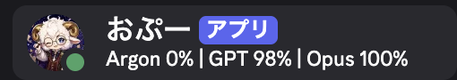
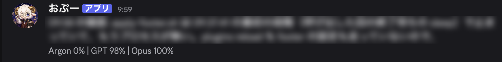

# openclaw-quota-presence

An [OpenClaw](https://github.com/openclaw/openclaw) plugin that shows how much
quota is left on each AI provider as your bot's **Discord custom status** — and,
if you want, as a small line under each reply:





*The custom status in the member list, and the optional [reply footer](#reply-footer)
(message text blurred).*

No model calls anywhere. Two parts:

1. **The plugin** (a Gateway service) collects the numbers and writes one line
   to `<state dir>/quota-presence/status.json` (`{ text, items, updatedAt }`,
   written atomically).
2. **[`automation/set-presence.js`](automation/set-presence.js)**, an OpenClaw
   automation *script payload*, reads that file every 15 minutes and, when the
   line changed, calls the Discord `set-presence` message action — the
   official, supported way to set the bot's presence.

The plugin never touches `@openclaw/discord`: OpenClaw 2026.10.2 gives a plugin
no way to set another plugin's Discord presence in-process.

The numbers come from:

| source | how | groups |
|---|---|---|
| Antigravity CLI | runs `agy -p /usage` (30 s timeout, one run at a time, lock file) | `agy:<slug of the first column>` — e.g. `agy:gemini-4-argon`, `agy:gemini-models`, `agy:claude-and-gpt-models` |
| OpenClaw provider usage | calls the Gateway's own `loadProviderUsageSummary` (the numbers behind `/status`) **inside the Gateway process** — never the `openclaw` CLI | `usage:<provider id>` — e.g. `usage:openai`, `usage:anthropic` |

Each group has windows: `5h`, `week`, `day`, or a slug of the provider's own
label (`opus`, `sonnet`, …). What each source gives (checked 2026-10-23,
OpenClaw 2026.10.2):

| source | windows | note |
|---|---|---|
| `agy:gemini-models` | `5h`, `week` | Antigravity's Gemini pool |
| `agy:claude-and-gpt-models` | `5h`, `week` | Antigravity's **own** pool for Claude/GPT models inside agy — not your Anthropic or OpenAI subscription |
| `agy:gemini-4-argon` | `week` | |
| `usage:openai` | `5h`, `week` | needs an OpenAI OAuth/token profile (ChatGPT subscription) |
| `usage:anthropic` | `5h`, `week`, then `sonnet` or `opus`, per-model limits (`slug` of the model name), `extra-usage` | needs an Anthropic OAuth/token profile in OpenClaw's auth store — see below |

All of them have a reset time (`{reset}`, `{resetAt}`) except the model
windows of `usage:anthropic` without one (`sonnet`/`opus`) and `extra-usage`.

### Claude through `claude-cli` has no usage group

If the agent runs Claude through the `claude-cli` runtime (Claude Code's own
login), there is **no `usage:anthropic`** — the numbers `/status` would show
for your Anthropic subscription are not available to this plugin:

- OpenClaw's Anthropic usage auth (`resolveAnthropicUsageAuth`, OpenClaw
  2026.10.2) looks for an admin key, then an OAuth/token profile, and
  **explicitly skips the `anthropic:claude-cli` profile**. Claude Code's login
  lives in `~/.claude/.credentials.json`, not in OpenClaw's auth store.
- `claude-cli` maps to `anthropic` (`resolveUsageProviderId`), so asking for
  either gives the same empty answer: `loadProviderUsageSummary({ providers:
  ["anthropic", "claude-cli"] })` returns nothing for them (checked on a Gateway
  whose Opus runs through `claude-cli`; `openai` came back fine).
- What would give it: an Anthropic OAuth profile in OpenClaw's auth store
  (`openclaw models auth login --provider anthropic`; a setup token without the
  `user:profile` scope gets a 403 and then needs `CLAUDE_AI_SESSION_KEY`), or
  an admin key (`ANTHROPIC_ADMIN_KEY`, which gives 30-day cost history, not
  5h/week windows). Not tried: a new profile is also there for the agent's
  `anthropic` models, so check the auth order before adding one.

`agy:claude-and-gpt-models` is a different pool (Antigravity's), so labelling
it "Opus" shows agy's Claude quota, not the one `claude-cli` uses.

## Install

```jsonc
{
  "plugins": {
    "allow": ["quota-presence"],
    "load": { "paths": ["/path/to/openclaw-quota-presence"] },
    "entries": {
      "quota-presence": {
        "enabled": true,
        // agent_end is a conversation hook; non-bundled plugins need this to refresh after each turn
        "hooks": { "allowConversationAccess": true },
        "config": {
          "items": [
            { "label": "Argon", "source": "agy:gemini-4-argon" },
            { "label": "GPT", "source": "usage:openai" },
            { "label": "Opus", "source": "usage:anthropic", "window": "opus" }
          ]
        }
      }
    }
  }
}
```

With no `items`, every group found is listed (`"items": "auto"`).

Then let the agent's message tool set the presence (the `presence` action gate
is off by default) and make sure custom status is not overwritten:

```jsonc
{
  "channels": {
    "discord": {
      "actions": { "presence": true }
      // and no "autoPresence": { "enabled": true }
    }
  }
}
```

Restart (or let the Gateway hot-reload), check that `status.json` appears, then
create the automation. Replace the placeholder with the real path first:

```sh
STATE=~/.openclaw   # your OpenClaw state dir
sed "s#__STATUS_FILE__#$STATE/quota-presence/status.json#g" automation/set-presence.js > /tmp/set-presence.js
openclaw automations create \
  --name "Quota presence" \
  --every 15m \
  --script /tmp/set-presence.js \
  --script-timeout-seconds 60 \
  --script-tool-budget 5 \
  --tools read,message \
  --session isolated \
  --no-deliver
openclaw automations run <job-id> --wait   # first run now, instead of in 15 minutes
```

The script keeps the line it applied in the job's state (`trigger.state`) and
sends again only when the line changes, or after an hour (a Discord reconnect
resets the bot's presence). It cuts the line to 128 UTF-16 code units. A missing
file, an empty line (every source down) or a file older than 6 hours leaves the
current status alone; a broken file or a failed `set-presence` fails the run,
so it shows in `openclaw automations runs` and the next run retries. Its
constants (`STATUS`, `REAPPLY_MS`, …) are at the top of the file.

## Config

| key | default | |
|---|---|---|
| `items` | `"auto"` | `[{ label, source, window, windows }]`. `window`: `min` (the tightest limit of the group; default), or a window id. `windows: ["5h", "week"]`: several windows, shown through `{windows}` |
| `template` | `"{items}"` | `{items}`, `{time}` (HH:MM in `timeZone`; unset = the host's zone) |
| `itemTemplate` | `"{label} {remaining}%"` | also `{used}`, `{window}`, `{reset}` (45m / 3h / 2d), `{resetAt}` (10/28 16:04), `{windows}`. With `windows`, `{remaining}`/`{window}`/… are the tightest of them |
| `missingTemplate` | `"{label} ?"` | an item with no data (none of its windows found); `false` hides it |
| `separator` | `" \| "` | |
| `windowTemplate` | `"{window} {remaining}%"` | one window inside `{windows}`; same placeholders as `itemTemplate`. A window the source lacks is left out |
| `windowSeparator` | `"・"` | between the windows of `{windows}` |
| `windowLabels` | `{}` | names for `{window}`, e.g. `{ "5h": "5h", "week": "1w" }`; others show their id |
| `resetAtFormat` | `"M/D HH:mm"` | `{resetAt}`: `YYYY` `M` `MM` `D` `DD` `H` `HH` `mm`, the rest literal |
| `resetAtTodayFormat` | unset | used instead when the reset is today (in `timeZone`), e.g. `"HH:mm"` |
| `resetPrecision` | `1` | `{reset}` units: `1` → `30h`, `2` → `1d6h` / `3h20m` (the last one rounded) |
| `timeZone` | unset | for `{resetAt}` (unset: **Asia/Tokyo**) and `{time}` (unset: the host's zone) |
| `maxLength` | `128` | Discord's custom status limit (UTF-16 code units); longer text is cut with `…` |
| `intervalMs` | `900000` | refresh every 15 minutes (minimum 60000) |
| `refreshOnAgentEnd` | `true` | also refresh after each agent turn… |
| `minUpdateIntervalMs` | `120000` | …but at most this often; a turn inside the gap schedules one refresh at its end |
| `staleAfterMs` | `10800000` | a source that fails keeps its last numbers this long (0 = forever) |
| `statusFile` | `<state>/quota-presence/status.json` | where the line is written |
| `agy` | `{ enabled: true, command: "agy", args: ["-p", "/usage"], timeoutMs: 30000, lockFile: "<state>/quota-presence/agy.lock" }` | |
| `usage` | `{ enabled: true, timeoutMs: 10000 }` | also `providers` (only these), `agentDir`, `module` (path to the dist chunk, if it cannot be found) |
| `footer` | `{ enabled: false, template: "-# {items}", channels: ["discord"], maxLength: 300 }` | add the status as a small line under each reply; **turns off Discord's streamed preview**. Can have its own display keys. See below |

### Examples

Rendered from the numbers of 2026-10-23 09:10 JST.

Short custom status (the default templates):

```jsonc
"items": [
  { "label": "Argon", "source": "agy:gemini-4-argon" },
  { "label": "GPT", "source": "usage:openai" },
  { "label": "AG-Claude", "source": "agy:claude-and-gpt-models" }
]
```
```
Argon 0% | GPT 100% | AG-Claude 100%
```

Short, with time to reset in two units:

```jsonc
"itemTemplate": "{label} {remaining}%·{reset}",
"resetPrecision": 2
```
```
Argon 0%·5d7h | GPT 100%·4h51m | AG-Claude 100%·7d
```

Detailed reply footer, both windows and when they reset (the status keeps the short line):

```jsonc
"footer": {
  "enabled": true,
  "items": [
    { "label": "Argon", "source": "agy:gemini-4-argon" },
    { "label": "GPT", "source": "usage:openai", "windows": ["5h", "week"] },
    { "label": "AG-Claude", "source": "agy:claude-and-gpt-models", "windows": ["5h", "week"] }
  ],
  "itemTemplate": "{label} {windows}",
  "windowTemplate": "{window} {remaining}% ↻{resetAt}",
  "windowLabels": { "week": "1w" },
  "resetAtTodayFormat": "HH:mm"
}
```
```
-# Argon 1w 0% ↻10/28 16:04 | GPT 5h 100% ↻14:00・1w 100% ↻10/30 03:01 | AG-Claude 5h 100% ↻14:03・1w 100% ↻10/30 09:03
```

### Reply footer

Off by default. With `footer.enabled: true` each outgoing Discord message ends
with one small line:

```
Here is the answer…
-# Argon 55% | GPT 84% | Opus 92%
```

```jsonc
"config": {
  "items": [ /* as above */ ],
  "footer": { "enabled": true }   // template "-# {items}", channels ["discord"]
}
```

- Turn it on or off with `"enabled"`, then **`openclaw plugins reload
  quota-presence --wait`** (or restart the Gateway): the hook is registered when
  the plugin loads, so a config hot reload alone does not add or remove it.
- The numbers are the plugin's cached ones (the same as `status.json`). Sending a
  message never runs `agy` or a usage request.
- It runs in OpenClaw's `message_sending` hook, which is called once per outgoing
  message **before** Discord splits long text, so the line is added once, at the
  very end of the last part.
- Exactly one line: footer lines already at the end of the text (an earlier one,
  or one the model copied from the chat) are replaced, so a resend or re-edit
  never stacks them. Other `-#` lines the model writes stay.
- Left alone: empty and attachment-only messages, `NO_REPLY` / `HEARTBEAT_OK`,
  reasoning quotes (`> 🧠 …`), text whose code block is still open, and anything
  before the first refresh (no `Argon ? | GPT ? | Opus ?` line). A text message
  with an attachment gets the line under its text.
- Every outgoing Discord message gets it, not only replies: the agent's own
  `message` tool sends, automation/cron deliveries and error notices too. If one
  turn sends several messages, each ends with the line.
- `channels: []` adds it on every channel; `template` must keep `{items}`.
- Its own `items`, `itemTemplate`, `separator`, `missingTemplate`,
  `windowTemplate`, `windowSeparator`, `windowLabels`, `resetAtFormat`,
  `resetAtTodayFormat`, `resetPrecision`, `timeZone`: any it leaves out come
  from the main config, so a footer with only `enabled` shows the same line as
  the custom status (as in 0.3.0). Changing them needs no reload. The line is
  cut to `footer.maxLength` (300); the custom status stays at 128.
- After changing the footer's items or templates, a footer in the old format
  is no longer recognised; an older message re-edited later may end up with
  both lines.

#### Effect on streaming (OpenClaw 2026.10.2)

`@openclaw/discord` checks, for every inbound message, whether any plugin has a
`message_sending` or `reply_payload_sending` hook; if so it does not create the
draft preview message (`allowProviderPreview` in the draft-preview controller).
So while the footer is on, **for every Discord reply of that Gateway**:

- `streaming.mode` `partial` / `block`: no live-updating draft; the reply
  appears in one go when it is done.
- `streaming.mode` `progress`: no tool-progress draft (the "working…" message
  with tool rows); the typing indicator still shows.
- If `agents.defaults.blockStreamingDefault` is `"on"` (and
  `streaming.block.enabled` is unset), losing the preview turns block streaming
  on: the reply goes out in several messages and each gets the line.
- Otherwise nothing changes: the final text, chunking, attachments, threads and
  the custom status are the same.

The two hooks that can change a reply's text are exactly the two that turn the
preview off, so there is no supported way to have both. The alternatives were
rejected: editing each reply again after it is sent marks every reply
"(edited)" and doubles the Discord calls; rewriting the transcript feeds the
line back to the model; patching or forking `@openclaw/discord` is out of scope.
So the footer stays opt-in and the trade-off is yours.
`footer.enabled: false` (and a reload) brings the preview back.

## How it works / limitations

- The plugin only fetches, formats and writes `status.json`, every refresh
  (so `updatedAt` shows it is alive). A failing source keeps its last numbers
  until `staleAfterMs`.
- The Discord side is the message tool's `set-presence` action
  (`activityType: "custom"`), called from an automation script — no model call,
  no Discord module loading, no extra bot connection or token.
- Up to one interval (15 min) between the file changing and Discord showing it.
- `set-presence` sets the default Discord account's presence. With several
  accounts, run the script for each (the action takes the job's account).
- Do not combine with `channels.discord.autoPresence` — it overwrites the
  status every few seconds.
- A presence API for other plugins would remove the automation step; see
  [`upstream/discord-presence`](../../upstream/discord-presence/README.md) for a
  proposed upstream change.
- `loadProviderUsageSummary` is not on the public plugin SDK; the plugin finds
  the hashed `dist/provider-usage-*.mjs` chunk that exports it. If an OpenClaw
  update renames it, set `usage.module` (and please open an issue).
- A provider OpenClaw cannot read usage for (no subscription/OAuth credential
  in the agent's auth store) has no `usage:` group — `/status` shows nothing
  for it either. Point the item at an agy group instead.

## Development

```
npm test   # node --test, no dependencies
```

## License

MIT
